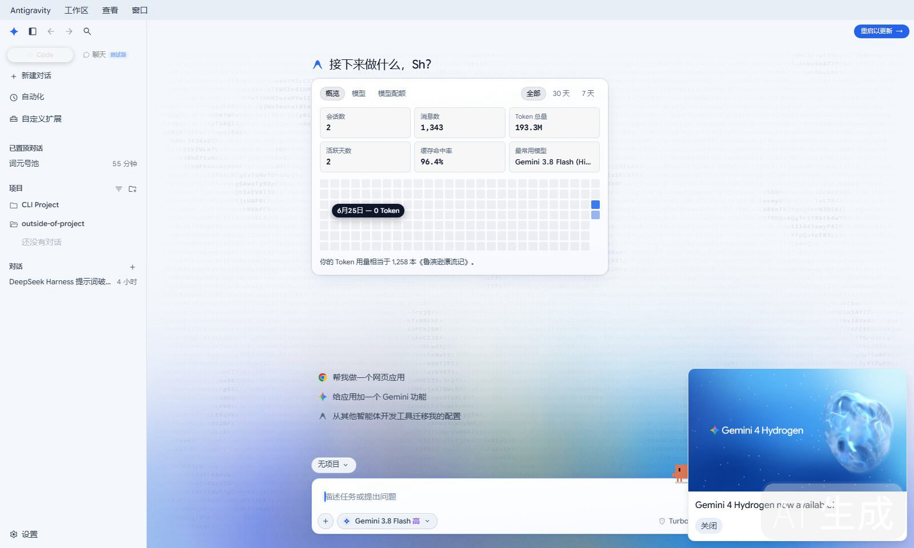
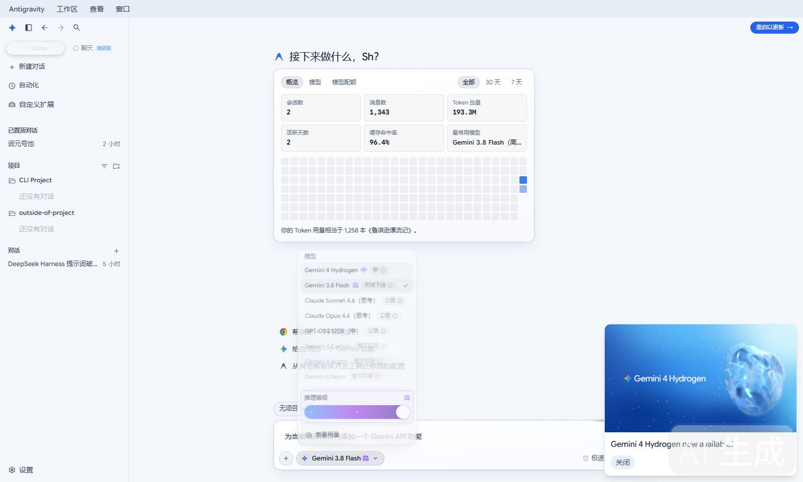
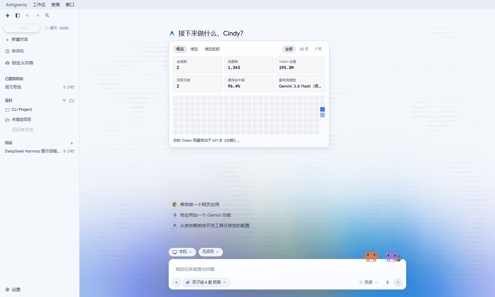
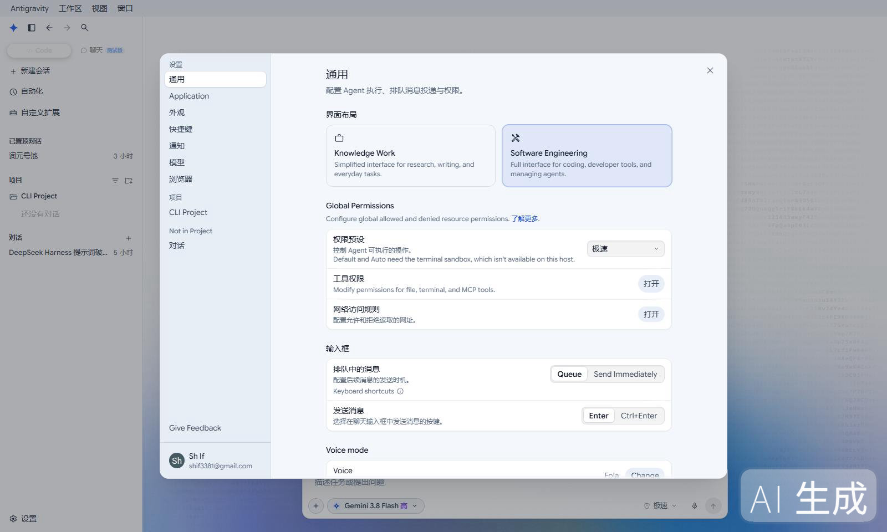
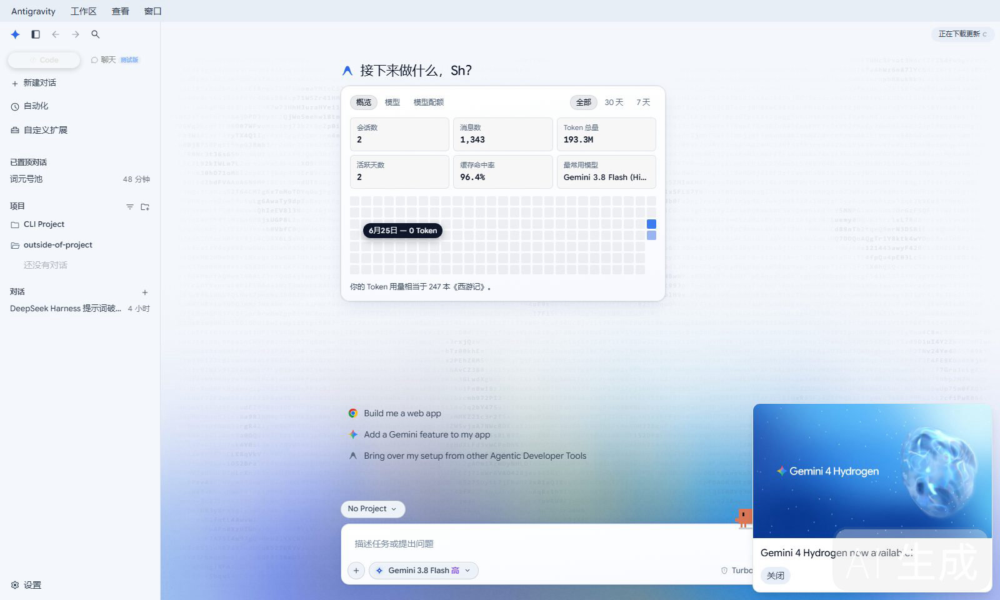

# antigravity-zh

**English** · [简体中文](./README.md)

> **Simplified Chinese Localization Plugin for Google Antigravity 2.x Desktop**  
> Built on the official plugin framework with zero client file modifications — easy to install and fully reversible.

[](https://github.com/marshallcindy725-cmyk/antigravity-zh/releases)
[](./LICENSE)


---

## ✨ Features

- **Comprehensive UI Coverage**: Ships with **2,181 unique entries** and **111 dynamic sentence patterns**, covering the main hub, sidebar, conversations, agent flows, model selector & notices, MCP, Git, settings, usage panels, and built-in browser.
- **Non-Invasive**: Runs as a standard plugin without modifying `app.asar`, binaries, or official configs — completely safe across app updates.
- **User Content Untouched**: Translates only UI controls, menus, tooltips, and dynamic counters; code blocks, chat messages, and project names stay intact.
- **Hot-Reloadable Dictionaries**: Edit any JSON file under `dictionaries/` and changes apply automatically within seconds without restarting Antigravity.
- **Zero External Dependencies**: Uses Antigravity's built-in runtime out of the box.

---

## 📸 Screenshots

| Main Hub | Model Selector | Model Pill |
|---|---|---|
|  |  |  |

| Settings | Usage |
|---|---|
|  |  |

---

## 📦 Installation (Windows)

### Option 1: One-Click Script (Recommended)

1. Download the latest archive (`antigravity-zh-v1.3.0-release.zip`) from [Releases](https://github.com/marshallcindy725-cmyk/antigravity-zh/releases) and extract it.
2. Open PowerShell in the extracted folder and run:
   ```powershell
   .\install.ps1
   ```
   > If blocked by PowerShell execution policy, run: `powershell -ExecutionPolicy Bypass -File .\install.ps1`
3. **Restart Antigravity** to enjoy the localized interface.

### Option 2: Manual Installation

1. Copy the `antigravity-zh` folder to `%USERPROFILE%\.gemini\config\plugins\antigravity-zh\`.
2. Add `"antigravity-zh": { "enabled": true }` to the `plugins` object in `%USERPROFILE%\.gemini\config\config.json`.
3. Restart Antigravity.

---

## 🗑️ Uninstallation

Run `.\uninstall.ps1`, or delete `%USERPROFILE%\.gemini\config\plugins\antigravity-zh\` and remove the `"antigravity-zh"` entry from `config.json`, then restart Antigravity to restore the original English UI.

---

## ⚙️ Configuration

The default `config.json` works out of the box for both standard and portable setups:

```json
{
  "userDataDirs": [],
  "portFiles": [],
  "logLevel": "info"
}
```

---

## 🤝 Contributing

Contributions are welcome! To add missing UI translations or suggest improvements, please check [dictionaries/README.md](./dictionaries/README.md) for formatting and terminology guidelines, then open an Issue or Pull Request.

---

## 📄 License & Disclaimer

- Released under the [MIT License](./LICENSE).
- Independent open-source community project, not affiliated with, endorsed by, or sponsored by Google LLC. No Google code or assets are modified or redistributed.
