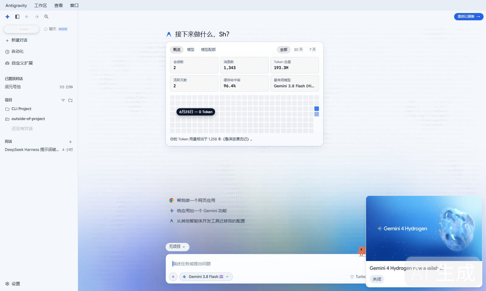
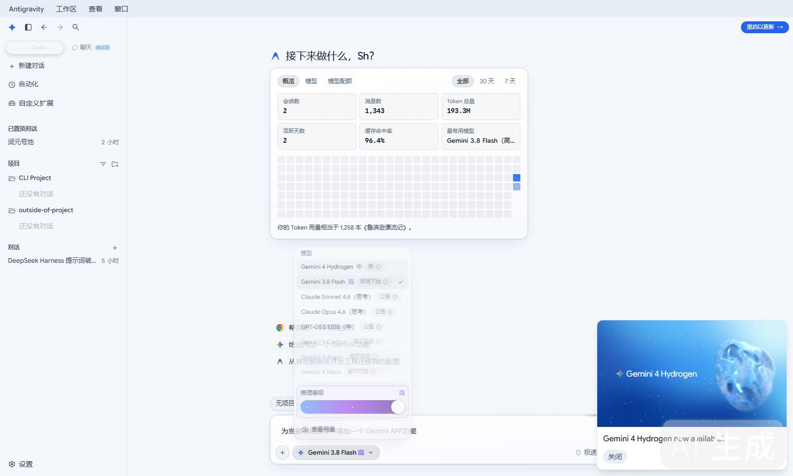
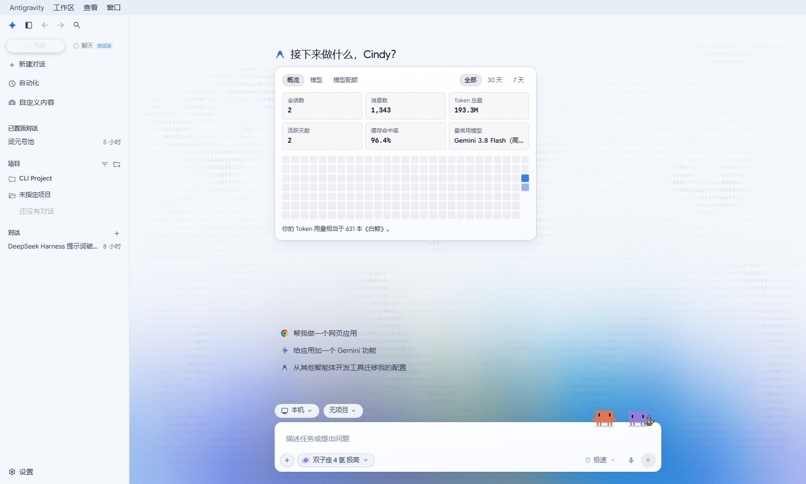
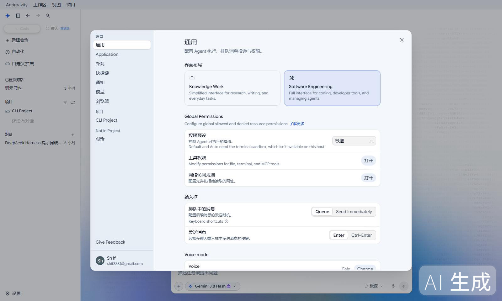
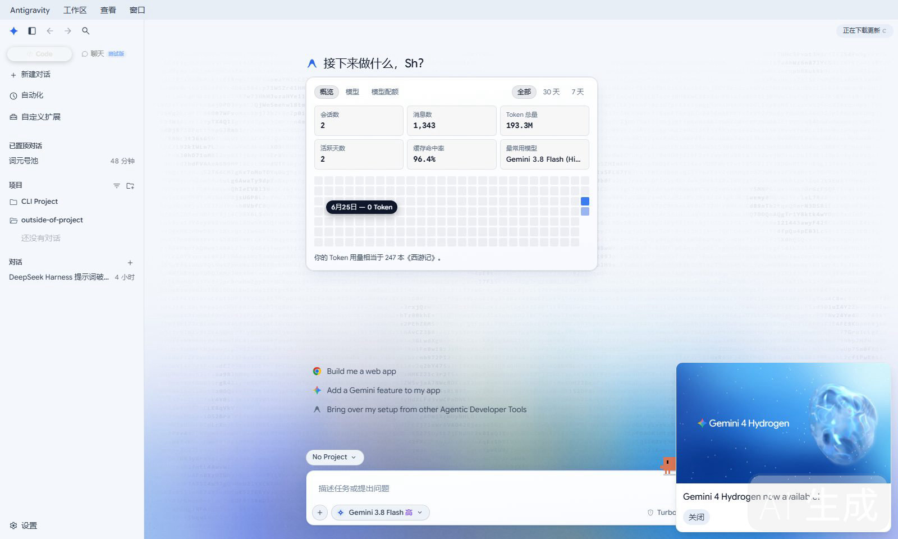

# antigravity-zh

[English](./README.en.md) · **简体中文**

> **Google Antigravity 2.x 桌面端简体中文汉化插件**  
> 基于官方插件体系实现，无需修改客户端任何文件，安装即用，随时可卸载还原。

[](https://github.com/marshallcindy725-cmyk/antigravity-zh/releases)
[](./LICENSE)


---

## ✨ 主要特性

- **全面覆盖界面文案**：内置 **2,181 条词条**与 **111 条动态句式**，涵盖主界面、侧边栏、对话流、Agent 交互、模型选择器与公告、MCP、Git、设置面板、用量统计与内置浏览器等区域。
- **无侵入，不改原文件**：作为官方插件运行，不修改 `app.asar`、程序二进制文件或原有配置，客户端后续版本升级不受影响。
- **智能隔离用户内容**：仅对界面控件、菜单、提示语与动态时间/计数进行翻译，代码块、对话正文与项目名称保持原样。
- **词典热更新**：修改 `dictionaries/` 下的 JSON 词典文件保存后即可实时生效，无需重启应用。
- **零额外依赖**：直接复用 Antigravity 内置运行环境，下载解压即可使用。

---

## 📸 界面预览

| 主界面 | 模型选择器 | 模型胶囊 |
|---|---|---|
|  |  |  |

| 设置面板 | 用量统计 |
|---|---|
|  |  |

---

## 📦 安装方法（Windows）

### 方式一：一键安装（推荐）

1. 前往 [Releases 页面](https://github.com/marshallcindy725-cmyk/antigravity-zh/releases) 下载最新版本压缩包（`antigravity-zh-v1.3.0-release.zip`）并解压。
2. 在解压后的文件夹内打开 PowerShell，运行安装脚本：
   ```powershell
   .\install.ps1
   ```
   > 如遇系统脚本执行策略限制，请改用：`powershell -ExecutionPolicy Bypass -File .\install.ps1`
3. **重启 Antigravity** 即可完成汉化。

### 方式二：手动安装

1. 将整个 `antigravity-zh` 文件夹复制到 `%USERPROFILE%\.gemini\config\plugins\antigravity-zh\`（如使用便携版或自定义目录，请放入对应的 `.gemini\config\plugins\` 路径）。
2. 编辑 `.gemini\config\config.json`，在 `plugins` 中加入：
   ```json
   "antigravity-zh": { "enabled": true }
   ```
3. 重启 Antigravity 即可。

---

## 🗑️ 卸载还原

在插件目录或解压目录中运行：

```powershell
.\uninstall.ps1
```

或手动删除 `%USERPROFILE%\.gemini\config\plugins\antigravity-zh\` 文件夹并移除 `config.json` 中的 `"antigravity-zh"` 项，重启 Antigravity 即可完全恢复为英文原版。

---

## ⚙️ 配置说明

插件根目录的 `config.json` 默认适配标准安装与常见便携路径，通常**无需调整**：

```json
{
  "userDataDirs": [],
  "portFiles": [],
  "logLevel": "info"
}
```

- `userDataDirs`：可选，若使用了非默认的用户数据目录，可在此指定包含 `DevToolsActivePort` 的目录路径。
- `portFiles`：可选，直接指定 `DevToolsActivePort` 文件路径。
- `logLevel`：日志输出级别（默认 `info`）。

---

## 📁 目录结构

```text
antigravity-zh/
├── plugin.json                         # 插件清单
├── config.json                         # 运行配置模板
├── install.ps1 / uninstall.ps1         # Windows 安装与卸载脚本
├── sidecars/zh-daemon/
│   ├── sidecar.json                    # 后台服务配置
│   ├── main.mjs                        # 汉化主服务（端口连接与词典加载）
│   └── inject-dom.js                   # 页面本地化脚本
├── dictionaries/                       # 模块化 JSON 词典
│   ├── core.json                       # 核心公共词条
│   ├── module-2.json … module-18*.json # 各功能模块词条
│   ├── patterns*.json                  # 动态句式规则
│   └── README.md                       # 词典编写与术语规范
├── screenshots/                        # 界面预览截图
├── CHANGELOG.md                        # 更新日志
└── LICENSE                             # MIT 许可证
```

---

## 🤝 参与贡献

如果在使用过程中发现未翻译的英文界面或有更好的译法建议，欢迎提交 Issue 或 Pull Request：

1. 在 `dictionaries/` 对应模块中添加词条（需与界面英文原文完全一致）：
   ```json
   "New Conversation": "新建对话"
   ```
2. 包含动态数字或变量的句子可添加到 `patterns*.json` 中。
3. 保存后即自动重载生效，详细格式与术语表请参阅 [词典格式说明](./dictionaries/README.md)。

---

## ❓ 常见问题

- **顶部系统菜单栏（File / Edit / View 等）为什么还是英文？**  
  顶部原生菜单栏属于系统级窗口组件，不在网页界面插件的作用范围内，因此保持英文原样。
- **Antigravity 更新版本后会受影响吗？**  
  不会。本插件不修改客户端文件，即使官方界面新增了文案，未覆盖部分也会自动以英文显示，不影响正常使用。
- **可以和其他 UI 美化插件一起使用吗？**  
  可以，与 Obsidian Prism 等插件互相独立，可同时启用。

---

## 📄 开源协议与声明

- 本项目采用 [MIT License](./LICENSE) 开源。
- 本项目为独立开源社区项目，与 Google LLC 无关，未获其认可或赞助；“Antigravity” 与 “Google” 仅作兼容性说明之用。
- 本项目不修改、不分发 Google Antigravity 的任何程序代码或资源文件，所有翻译词条均为独立编写。
